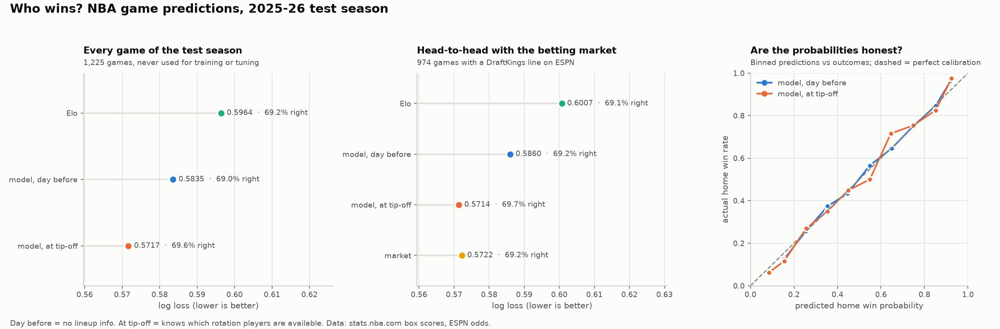

# nba-ai

Predicts who wins an NBA game, as a probability, from box scores, player ratings, schedule and
(optionally) the betting line. 20+ seasons of data, every feature computed strictly from games
before tip-off, every choice made on walk-forward validation, and one untouched test season.

```sh
uv sync
uv run nba-ai fetch                     # box scores 2004-05..now (stats.nba.com) + ESPN odds -> data/
uv run nba-ai train                     # build features, fit, score the 2025-26 test season once
uv run nba-ai report                    # report.png
uv run nba-ai predict --date 2026-11-09 # win probabilities for a day's games
uv run pytest                           # leakage tests
```

## Results



**Test season 2025-26** (1,225 games, scored once, never used for training or tuning):

| model | log loss | accuracy |
|---|---|---|
| Elo (tuned) | 0.5964 | 69.2% |
| model, day before (no lineup info) | 0.5835 | 69.0% |
| **model, at tip-off** (knows which rotation players are active) | **0.5717** | **69.6%** |

**Against the betting market** (the 974 test games with a DraftKings line): tip-off model
0.5714, market 0.5722. That's a tie within noise. The day-before model (0.5860) trails the
market. Feeding the market line to the model as an input didn't help: on 2017-23 the stack
scored 0.6068 against 0.6054 for the market alone. The closing line already contains
everything in a box score.

**Walk-forward validation** (2021-22..2024-25, 4,915 games): ensemble 0.6025 at tip-off,
0.6133 day before; Elo 0.6278. Every experiment is logged in `results.csv`.

What moved the needle, in order: player availability weighted by adjusted plus-minus
(-0.010 log loss), schedule/rest (-0.0025), the ensemble over a single logistic model (-0.0015).
What didn't: LightGBM on its own (worse than logistic), weighting recent seasons, a
plus-minus-based player model (-0.0003 for 13x the compute), adding the market as a feature.

## How it works

**Data.** `LeagueGameLog` from stats.nba.com via `nba_api` gives every player and team box score
since 2004-05. ESPN's public API gives the schedule and the pregame market line (`pickcenter`):
spreads for 2012-13..2022-23, moneylines from 2017-18, and DraftKings lines again from late 2025.

**Features** (`src/nba_ai/features.py`), all home-minus-away plus raw levels:

| group | what |
|---|---|
| ratings | Elo (margin-of-victory, season carry-over, tuned), opponent-adjusted offense/defense (time-weighted ridge, refit daily) |
| form | EWMAs at 5/15/40-game half-lives of net/off/def rating, pace, the four factors on both ends, 3-point rate |
| players | adjusted plus-minus per player from game margins weighted by minutes (ridge toward a box-score prior, refit weekly), summed over the expected rotation |
| availability | day-before: last game's rotation; at tip-off: which *rotation* players are actually active |
| schedule | rest, back-to-backs, games in last 7 days, travel distance, altitude, league-wide home edge drift |
| market | spread, vig-free moneyline probability, total |

**Models** (`src/nba_ai/models.py`): logistic regression, a PyTorch MLP and a LightGBM margin
regressor (margin → probability through a fitted normal), averaged in logit space.

**Validation.** Walk-forward: for each of 2021-22..2024-25, train on every earlier season and
score that season. All tuning used those folds. 2025-26 is scored once at the end.

**Leakage guards** (`tests/test_features.py`): deleting every game after a date must not change
any feature before it, and adding a garbage-time player to a box score must not change any
tip-off feature. The second test exists because an early version leaked: who checks in late is
decided by the score (blowouts empty the bench), so "everyone who played" partly encodes the
result. Tip-off features now count only rotation players.

`nba_train.py` is the original learning script (MLP vs a tiny transformer on player points).
